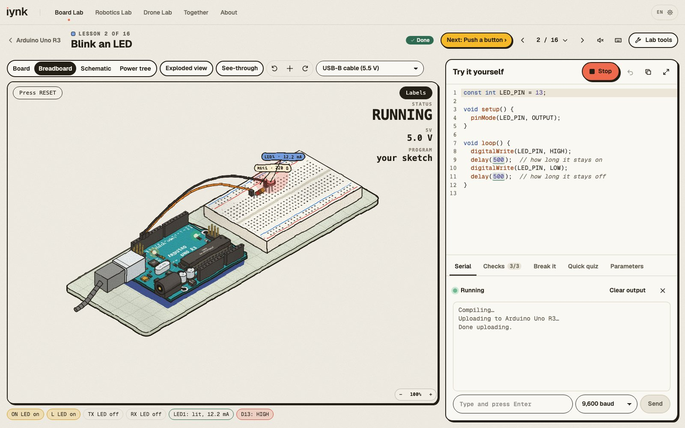

# iynkware

iynkware is the headset version of [iynk](https://iynk.tech), a free hardware lab in the browser. On a Meta Quest 3S,
with controllers or hand tracking, a person builds hardware projects on a spatial workbench in passthrough, runs and
breaks them in real simulation, does science labs, flies the drone they built around their own room, and talks to an
AI companion that watches the bench and builds with them.

**Live demo:** https://iynkware-xr.asnu.workers.dev/ — open it in the Quest's browser and press Enter; it also runs
flat on a desktop browser. The headset app lives in `xr/` and was built during Immerse the Bay 2026 (StanfordXR) on
top of the 2D iynk app, which this repository holds too (copied from iynk on 2026-11-14 with no shared history).
[docs/DEVPOST.md](docs/DEVPOST.md) is the submission write-up: what it does, how the AI works, and the social-good
case. [docs/STATE.md](docs/STATE.md) is the record of what exists and what does not; where this page and it disagree,
it wins.

## What exists today

The full 2D iynk product (Next.js 16, React 19, TypeScript), with all of its simulation in the browser:

- **Labs:** <!--count:items-->38<!--/count--> catalogue items modelled on real hardware:
  <!--count:boards-->12<!--/count--> boards with lessons, <!--count:robotics-->13<!--/count--> robotics benches and
  <!--count:drones-->13<!--/count--> drones with a flight sim. Each has a hand-inked figure you can turn round, see
  through and take apart.
- **Studio:** your own projects on a canvas, with breadboard, schematic and board views of one circuit, a circuit
  solver that runs while you edit, Firmware mode (a `.hex` on the Uno's AVR, a `.uf2` on the Pico), Wokwi import,
  KiCad netlist and SPICE export, and sharing a project as a link.
- **Simulation:** interpreters for a teaching subset of Arduino C++, MicroPython, Python and Verilog, a DC circuit
  solver, a drone calculator, a flight model, and an engine host for avr8js, rp2040js, yosys and rapier physics.
- **Server, optional:** the collaboration server in `server/` (identity, rooms, buddies, stored shares) and the AI,
  search and MCP routes, which stay off unless the person running it turns them on.
- **Also:** six languages (en, de, es, fr, hi, zh) for the UI and the lesson prose, the `iynk` command line, Docker
  files for running your own copy, Vitest and Playwright tests, and the local gate `scripts/ci-local.sh`.

It teaches how parts behave. By default code runs in iynk's own interpreter on a virtual clock, not on a real chip, so
a program written for a real toolchain may not run. Numbers such as the current through a burnt LED come from a simple
model and are there to show the idea. It does not replace a bench, a compiler or a datasheet.



## The headset app

What a person can do today, in six languages, with hands or controllers ([docs/DEVPOST.md](docs/DEVPOST.md) tells it
in full, [docs/STATE.md](docs/STATE.md) keeps the checked record):

- **Bench:** parts from a shelf, wiring by hand with grabbable wire ends, movable panels with grip bars, Tidy up,
  Recentre, and a Home panel that reaches everything.
- **Run:** the circuit simulated in a Web Worker on the device — current dots on the wires, node voltages, LED halos,
  an editable code window that marks the running line, meters and a fault lab.
- **Learn:** guided lessons with highlights on the bench, checks, and first-run onboarding.
- **Labs:** chemistry, physics, electrical and signals — practice and exam, a tutor, and a Data tab that plots what
  you measure. Switched from Home.
- **Range:** design a quad on the drone workbench, fly it in your room on a course scaled to your space, FPV and
  chase screens, crash replay at the crash point, "Simulate here" around you, and robot arenas on the floor.
- **AI companion:** hold Talk and speak (Gemini Live through a Cloudflare token broker; the key never reaches the
  headset). It navigates you anywhere, proposes edits as ghosts, builds circuits and drones with you step by step,
  and follows the bench through structured events — no camera.

| Piece | Where | Its doc |
|---|---|---|
| The headset app, on the Meta Immersive Web SDK and three.js, built with Vite | `xr/` | `docs/XR_ARCHITECTURE.md` |
| The voice companion: tools, coach, Gemini Live | `xr/src/agent/` | `docs/XR_AGENT.md` |
| 3D assets generated from the figure sources in `figures/` | `tools/xr-assets/` | `docs/XR_ASSETS.md` |
| Deployment of the headset app to Cloudflare | `deploy/cloudflare-xr/` | `docs/XR_DEPLOY.md` |

The headset app reuses the 2D app's simulation, project, content and i18n code; `docs/XR_ARCHITECTURE.md` sets the
folder layout and the shared contract files. What in the 2D app refuses WebXR today (the Permissions-Policy and the
content security policy) is under open items in docs/STATE.md.

## Run the 2D app

The repository is private; zero-abd adds collaborators. You need Node 24 (from `.nvmrc`), npm and Python 3.

```bash
git clone https://github.com/zero-abd/iynkware.git
cd iynkware
nvm use
npm ci
npm run dev
```

Open the address `next dev` prints (http://localhost:3000 by default). The labs, the figures, the interpreters and the
flight sim work with no key and no setup. When several copies run on one machine, give each its own port and build
folder as [docs/COLLABORATION.md](docs/COLLABORATION.md) section 4 shows.

Every setting is optional and named in `.env.example`; `.env.local` is never committed. The AI partner and search stay
off until the person running the server turns them on; each person then pastes their own key in Settings, where it
stays in the browser. [docs/SELF_HOSTING.md](docs/SELF_HOSTING.md), [docs/SERVER_AND_KEYS.md](docs/SERVER_AND_KEYS.md)
and [docs/DATA_HANDLING.md](docs/DATA_HANDLING.md) explain it, though they still name the older `/api/*` routes: the
routes now live in `server/`.

There is no hosted CI: checks run on your machine, and the PR description is the record. Every PR runs the fast set
below. The full gate is `bash scripts/ci-local.sh` with no options; when it is required, and the traps, are in
[docs/COLLABORATION.md](docs/COLLABORATION.md) section 6.

```bash
NODE_OPTIONS=--max-old-space-size=4096 bash scripts/ci-local.sh --only content,typecheck,lint,ui,no-only,copy
```

## Working here

- [AGENTS.md](AGENTS.md): read first; the hard rules and the loop from issue to merged PR.
- [docs/COLLABORATION.md](docs/COLLABORATION.md): claiming issues, branches and worktrees, ports, checks, PRs.
- [CONTRIBUTING.md](CONTRIBUTING.md): adding a string in six languages, a lesson or a part.
- [HANDOFF.md](HANDOFF.md): iynk's handoff, kept for reference. Its paths, services, ports and commit rules are iynk's.
- [SECURITY.md](SECURITY.md) and [CODE_OF_CONDUCT.md](CODE_OF_CONDUCT.md).

## Project layout

```
xr/                      the headset app
tools/xr-assets/         3D assets from the figure sources
deploy/cloudflare-xr/    the headset app's Cloudflare deployment and voice token broker
src/app                  pages and API routes of the 2D app, one page per lab item, in six languages
src/components           lab UIs, Studio, the shell, the landing page, shared ui
src/content              boards, benches and drones: lessons, steps, faults, checks
src/project              the project document: schema, storage, files, lab items as projects
src/core, src/protocol   shared cores, imported as #core/* and #protocol/*
src/sim, src/sim-host    the circuit solver, part models and the engine host
src/parts                the parts registry
src/lib                  interpreters, drone calculator, flight model, settings, CSP
src/i18n                 messages and lesson prose in six languages
figures                  figure sources and engines, built into public/figures
server                   the collaboration server, with the AI, search and MCP routes
deploy                   Dockerfiles, compose and Caddy for running your own copy of the 2D app
e2e                      Playwright tests
docs                     design notes per area; sourced fact sheets in docs/facts
```

## Licence

No licence has been chosen for iynk, and iynkware carries the same position: see
[LICENSE-PENDING.md](LICENSE-PENDING.md). No file grants a right to copy, change or redistribute the code. Describe
iynk and iynkware as free, and use no licence term for either. Third-party code keeps its own licence: Colorfigures is
MIT, and the licences of the npm packages are reproduced in `NOTICE`.

## Credits

- [iynk](https://iynk.tech) by Amar Kushwaha: the 2D app this repository starts from.
- [Colorfigures](figures/vendor/colorfigures/LICENSE) by April Zhu (MIT), built on iso-glow by April Zhu and
  iso-figure by Tolga Cohce. iynk's changes are in `figures/vendor/colorfigures/PATCHES.md`.
- Three teaching sites inspired iynk: Learn Arduino by Dilum Sanjaya, Robotics Engineer and Drone Engineer. Some
  constants, reference tables and the lesson structure follow them. [docs/PROVENANCE.md](docs/PROVENANCE.md) records
  where, and which rows are still open.
